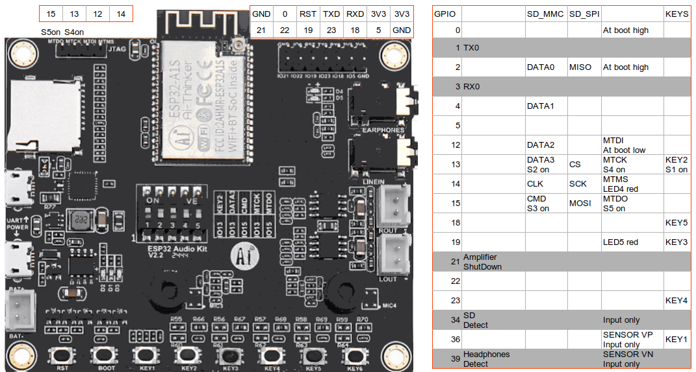

# ESP32BGM — Background Music Module




A stand-alone background-music player built on the **Ai-Thinker ESP32 Audio Kit**
(ESP32-A1S module, ES8388 codec). It plays internet radio or music from the SD
card and is controlled from a built-in web page.

> **`main` is the native ESP-IDF 5.x firmware** (developed on `idf-port`). The
> original Arduino/PlatformIO version is on the `bgm-core` branch.

## Features

- **Two playback sources**
  - **Radio URL**: HTTP and HTTPS Icecast/Shoutcast streams, with a station list
    you can edit from the browser. `.m3u`/`.pls` playlist URLs are followed to
    the first stream. Streams are pre-buffered (128 KB ring in PSRAM) and
    reconnect on their own when they drop.
  - **SD card**: every supported file under `/music` (sub-folders included),
    played in sorted order and looped.
  - FTP library (planned; the stub returns “not implemented”).
- **Espressif `esp_audio_codec` decoder**, the same one the Basmio project uses:

  | Format | Extensions | Radio MIME |
  |---|---|---|
  | MP3 | `.mp3` | `audio/mpeg` |
  | AAC / HE-AAC (ADTS) | `.aac` | `audio/aac`, `audio/aacp` |
  | M4A (AAC in MP4) | `.m4a`, `.mp4` | `audio/mp4` |
  | FLAC | `.flac` | `audio/flac` |
  | OGG Vorbis / Opus | `.ogg`, `.oga`, `.opus` | `audio/ogg`, `audio/opus` |
  | WAV (PCM / ADPCM) | `.wav` | `audio/wav` |

- Hardware volume on the ES8388, plus a sound chain tuned for an **exciter**:
  mono switch, bass/treble, a “wide & deep” sound enhancer, an adjustable
  exciter-protection high-pass and a resonance notch (see [Sound](#sound)).
- Web UI: the main player, a station manager, SD card info and a diagnostics
  page. The pages are built into the firmware, so there is no filesystem upload.
- Wi-Fi setup through a captive portal. When no Wi-Fi is configured, or the
  connection fails, the device opens the `ESP32-Radio-Setup` AP (password
  `radiosetup`).
- Settings are kept across reboots in NVS: mode, volume, EQ, last station,
  last track and the station list.
- **OTA firmware updates** from the web UI (`/update`), with automatic rollback
  if the new image doesn't come up. Only images signed with your RSA-3072 key
  are accepted.
- **Remote logs**: every log line is kept in a 32 KB ring buffer, viewable
  live at `/logs` or over TCP with `nc <device-ip> 2323`.

## Hardware

| Part | Details |
|---|---|
| Board | Ai-Thinker ESP32 Audio Kit v2.2 (ESP32-A1S, 4 MB flash, PSRAM) |
| Codec | ES8388: I2C SCL 32 / SDA 33, I2S MCLK 0 / BCLK 27 / WS 25 / DOUT 26, PA enable 21 |
| Storage | microSD, SDMMC 1-bit (CLK 14, CMD 15, D0 2) |
| Output | Headphone jack / speaker amp on the kit |

> **DIP switches**: SD 1-bit mode must not clash with the keys or JTAG. Use the
> setting from the Ai-Thinker docs for SD + audio.

A 3D-printable enclosure (STL + FreeCAD) is in [`Docs/housing`](Docs/housing).

## Architecture

```
 Radio URL ──► reader task (esp_http_client, core 0) ──► 128 KB PSRAM stream buffer ─┐
                                                                                     │
 SD card  ───► FILE* on FATFS (/sdcard, 16 KB buffer) ───────────────────────────────┤
                                                                                     ▼
                                                 audio task (core 1): 2 KB chunks per lock hold
                                                                                     │
                                                    EspAudioDecoder (esp_audio_codec)
                                                                                     │ PCM 16-bit stereo
                                                                                     ▼
                                    sound chain (audio_dsp) ──► esp_codec_dev ──► ES8388 / I2S
                                         (the codec is reopened when the source sample rate changes)
```

| File (`main/`) | Role |
|---|---|
| `main.cpp` | Constants, global state, `app_main()` |
| `app_state.h` | Shared types and every cross-module declaration |
| `audio_decoder.cpp/.h` | `EspAudioDecoder`, a wrapper around the Espressif simple decoder |
| `audio_output.cpp` | I2C + I2S + ES8388 through `esp_codec_dev`, volume, sample-rate changes, I2C recovery |
| `audio_dsp.cpp` | Sound chain: mono, tone, enhancer, width, protection, notch, limiter |
| `audio_task.cpp` | Audio task, the state lock (a recursive mutex), starting/stopping streams, codec detection |
| `mode_manager.cpp` | Switching modes, play / pause / stop / select |
| `source_radio.cpp` | HTTP(S) stream sessions, playlist following, pre-buffering, recovery |
| `source_sd.cpp` | SD mount, recursive library scan, track playback and auto-advance |
| `source_ftp.cpp` | FTP stub |
| `network_manager.cpp` | Wi-Fi STA with auto-reconnect, the setup AP |
| `captive_dns.cpp` | DNS server that sends every hostname to the setup AP |
| `settings_store.cpp` | NVS settings (namespace `radio`) and the stations JSON |
| `web_server.cpp` | `esp_http_server` routes and HTML templating, the OTA upload handler |
| `ota_update.cpp` | OTA slot writing, boot check and rollback timer |
| `log_stream.cpp` | `esp_log` hook, PSRAM ring buffer, TCP log server |
| `web/*.html` | Web UI templates (embedded with `EMBED_TXTFILES`) |

Dependencies come from the ESP Component Registry (`main/idf_component.yml`):
`espressif/esp_audio_codec` and `espressif/esp_codec_dev`.

### Decoder notes

- `EspAudioDecoder` accepts chunks of any size. It keeps a 16 KB input buffer,
  and the Espressif parser finds frame boundaries and resyncs after corrupt data.
  If 16 KB in a row can't be parsed, they are dropped so playback can recover.
- ID3v2 tags (including large embedded cover art) are skipped before decoding.
- HE-AAC (AAC+/SBR) is enabled, since many AAC radio streams use it.
- The output is always 16-bit stereo: mono is duplicated to both channels, and
  8/24/32-bit sources are converted. When the sample rate changes, the codec is
  reopened at the new rate.
- When an SD track ends, `finish()` flushes the parser (FLAC needs an
  end-of-stream signal) before the next track starts.
- M4A files need the `moov` atom before the audio data (“fast start”) to play
  as a stream. Re-mux with `ffmpeg -i in.m4a -c copy -movflags +faststart out.m4a`
  if needed.
- HLS (`.m3u8` with `#EXT-X-` segments) is not supported.

## Sound

The board outputs stereo; the chain below runs on every frame before the
ES8388, in this order. All controls are in the **Sound** section of the main
page and are saved with **Save as Default**.

| Stage | Control | What it does |
|---|---|---|
| Mono | checkbox, off by default | Equal-power downmix (L+R)/√2 to both channels, for a single exciter |
| Headroom | automatic | Attenuates the input by the largest active boost so loud masters don't clip (the volume is applied after the chain, in the codec) |
| Bass / Treble | −10…+10 | Biquad shelves at 120 Hz / 6 kHz, ±12 dB (from Basmio) |
| Sound enhancer | 0 = off, 1–40 Warm, 41–75 Full, 76–100 Punch | From Basmio. **Deep**: psychoacoustic bass (harmonics of the low band, above 78 Hz) plus a 175 Hz fullness shelf (up to +11.8 dB) and a 4.8 kHz presence shelf (up to +4 dB); this part fades out between 45 % and 72 % volume, like loudness compensation. **Wide**: mid/side side boost up to +50 %, stereo only, independent of volume |
| Exciter protection | 0 = off, 40–400 Hz (default 80 Hz) | 4th-order Butterworth high-pass (−24 dB/octave), placed after the enhancer so nothing it adds reaches the exciter below the cut-off |
| Resonance notch | 100–2000 Hz, 0 = off … −12 dB | Narrow peaking cut (Q 2.5) to take the exciter or panel resonance down |
| Limiter | automatic | Soft knee above −0.8 dBFS |

Tuning an exciter: start with the protection at or a little above the
exciter's rated low limit (often its resonance, F<sub>s</sub>). Then sweep the
notch frequency at −6 dB while music plays and leave it where the boominess or
rattle drops. Add the enhancer last.

With everything on, the chain uses about 8 % of real time on one core
(measured on the board; logged once a minute as `audio_out: DSP load`).

## Releases

Each [GitHub release](https://github.com/cugetare/ESP32BGM/releases) carries
the signed app image plus the files for a first-time USB flash:

| File | Use |
|---|---|
| `ESP32BGM.bin` | Signed app: install from `/update` (OTA), or flash at `0x20000` |
| `bootloader.bin`, `partition-table.bin`, `ota_data_initial.bin` | Only for a first USB flash, or when coming from an older partition layout |

First flash over USB, without building (port as needed):

```bash
python -m esptool --chip esp32 -p COM3 -b 921600 write_flash --flash_mode dio --flash_freq 80m 0x1000 bootloader.bin 0x8000 partition-table.bin 0x19000 ota_data_initial.bin 0x20000 ESP32BGM.bin
```

A release image is signed with the project key, so a device running a build
signed with a different key rejects it over OTA. Flash it over USB instead.

## Building & flashing

Requires **ESP-IDF 5.4 or newer** (developed with 5.5.1).

```bash
idf.py set-target esp32
```

```bash
idf.py build
```

```bash
idf.py -p COM5 flash monitor
```

Replace `COM5` with your board's serial port. The first build downloads the
managed components. `sdkconfig.defaults` turns on PSRAM, the custom partition
table, OTA rollback, HTTPS with the certificate bundle, FATFS long file names
and the Wi-Fi/LWIP buffer sizes for streaming. It also switches off the
`esp_audio_codec` formats BGM never plays (AMR, G.711, G.722, LC3, SBC, ALAC,
MPEG-TS, all encoders), which takes the app from 1.83 MB to 1.64 MB.

| Partition | Offset | Size |
|---|---|---|
| `nvs` | 0x9000 | 64 KB |
| `otadata` | 0x19000 | 8 KB |
| `phy_init` | 0x1B000 | 4 KB |
| `ota_0` | 0x20000 | 1920 KB |
| `ota_1` | 0x200000 | 1920 KB |

If you change `sdkconfig.defaults`, delete `sdkconfig` before building so the
new defaults are applied.

## Firmware updates (OTA)

1. Build with `idf.py build`.
2. Open `http://<device-ip>/update`. The page shows the running version and slot.
3. Pick `build/ESP32BGM.bin` and press **Upload & install**. Playback stops,
   the image is written to the other slot and verified, and the device reboots.

The upload also works from the command line:

```bash
curl -X POST -H "Content-Type: application/octet-stream" --data-binary @build/ESP32BGM.bin http://192.168.2.119/update
```

The new image boots in “pending verify” state. It is marked valid once the web
server is running (so you can always reach it for the next update). If it
crashes before that, or doesn't get there within 120 s, the bootloader goes
back to the previous slot. A file that isn't an ESP32 image is rejected right
away and playback resumes. Bump `VERSION` for each release so `/update` shows
what is running.

### Signed firmware

Every build is signed (`build/ESP32BGM.bin`; the unsigned image is
`build/ESP32BGM-unsigned.bin`). The running firmware checks the signature at the
end of an upload and refuses anything that isn't signed with the same key
(`Image verification failed: ESP_ERR_OTA_VALIDATE_FAILED`, with `image valid,
signature bad` in the log).

- This is ESP-IDF's “signed app images without Secure Boot”, with the RSA scheme
  (needs ESP32 rev ≥ 3.0, hence `CONFIG_ESP32_REV_MIN_3`). **No eFuses are
  burned and the bootloader doesn't check signatures**, so flashing over USB
  always works and can undo all of it.
- The private key is read from `../ESP32BGM-keys/ota_signing_key.pem`, a folder
  next to the project, set in `CONFIG_SECURE_BOOT_SIGNING_KEY`. `*.pem` is in
  `.gitignore`. **Keep a backup of the key**: without it the device takes no
  more OTA updates until you flash it over USB with a build signed by a new key.
- To create a key on a new machine:

  ```bash
  python -m espsecure generate_signing_key --version 2 --scheme rsa3072 ../ESP32BGM-keys/ota_signing_key.pem
  ```

- To check a build locally:

  ```bash
  python -m espsecure verify_signature --version 2 --keyfile ../ESP32BGM-keys/ota_signing_key.pem build/ESP32BGM.bin
  ```

The web UI itself has no password: the device is meant for a trusted home
network. Anyone on that network can change settings or reboot it, but can't
install firmware without the key.

## Logs

- **Browser**: `http://<device-ip>/logs` polls once a second and highlights
  warnings and errors. It has Follow and Pause switches.
- **TCP**: `nc <device-ip> 2323`, or PuTTY in “Raw” mode on port 2323. You get
  the buffered history first, then live lines. Up to 2 clients at a time.
- **Serial** keeps working as before (`idf.py monitor`).

The buffer holds the last 32 KB of output, including the whole boot (the hook is
installed first thing in `app_main`).

## Usage

1. On first boot, connect to the **ESP32-Radio-Setup** Wi-Fi network (password
   `radiosetup`). The captive portal opens the main page (or browse to
   `http://192.168.71.1/`); go to **Setup** and enter your Wi-Fi network.
2. Once the device is connected, open the IP address shown on the serial
   monitor (`net: connected, IP …`) in a browser.
3. Choose **Radio URL** or **SD Card**, then use Play / Pause, the station or
   track list, volume and EQ.
4. Add or remove stations on **Manage**. For a radio station you can enter the
   MIME type (for example `audio/aac`); leave it empty to use the server's
   `Content-Type`, then the URL extension.

### SD card layout

```
/music/
  Album A/01 - Track.mp3
  Album B/song.flac
  ambient.ogg
```

If `/music` doesn't exist, the root of the card is scanned instead. Up to 1000
tracks are indexed.

### HTTP API

| Route | Method | Parameters |
|---|---|---|
| `/` | GET | Main page |
| `/setmode` | POST | `m` = `0` radio, `1` SD, `2` FTP |
| `/play`, `/pause` | POST | — |
| `/selectitem`, `/setstation` | GET/POST | `i` (or `s`) = item index |
| `/setvolume` | GET/POST | `v` = 0–100 |
| `/setbass`, `/settreble` | GET/POST | `v` = −10…10 |
| `/setsound` | GET/POST | `k` = `mono` (0/1), `enh` (0–100), `hpf` (0 or 40–400 Hz), `nhz` (100–2000 Hz), `ndb` (0–12 dB cut); `v` = value |
| `/savedefaults` | GET/POST | Saves the current settings |
| `/refreshlibrary` | POST | Rescans the SD card / reloads stations |
| `/getstations` | GET | Station list (JSON) |
| `/addstation` | GET/POST | `name`, `url`, optional `mime` |
| `/deletestation` | GET/POST | `id` |
| `/sdinfo`, `/diagnostics` | GET | Status pages |
| `/savewifi` | POST | `ssid`, `password` |
| `/setup`, `/resetwifi`, `/reboot` | GET | Wi-Fi and system |
| `/update` | GET | Firmware page (version, slots) |
| `/update` | POST | Raw `.bin` body, `application/octet-stream` |
| `/logs` | GET | Live log page |
| `/logtail` | GET | Log text since `from` (all of it without); next position in the `X-Log-Pos` header |

Any other path returns the main page, which is what captive-portal checks expect.

## Changes from the Arduino version

| Area | Arduino (`bgm-core`) | ESP-IDF (`idf-port`) |
|---|---|---|
| Framework | Arduino core 2.0.17 (IDF 4.4) | ESP-IDF 5.x |
| Codec driver | arduino-audio-driver | `esp_codec_dev` (ES8388) |
| Volume | Software gain | ES8388 hardware volume |
| Radio buffer | 64 KB, read in the audio task | 128 KB PSRAM, filled by a separate reader task, with pre-buffering |
| HTTPS / playlists | No | Yes (certificate bundle) / `.m3u`, `.pls` |
| Web pages | LittleFS, needs `uploadfs` | Built into the firmware |
| Stations | `/stations.json` on LittleFS | JSON blob in NVS (`radio/stations`) |
| Wi-Fi drop | Reconnected only when the radio recovery ran | Reconnects on its own |
| No credentials in SD mode | No web UI | Setup AP starts |
| Static internal RAM | ~94 KB | ~37 KB |
| Updates | USB only | Signed OTA from the web UI, with rollback |
| Logs | Serial only | Serial + `/logs` + TCP 2323 |
| Sound | Software volume, 3-band EQ | Hardware volume; mono, biquad tone, enhancer, exciter protection, resonance notch |

### Not yet at feature parity

- **Chip temperature** on the diagnostics page shows “Unavailable”: IDF 5
  supports no temperature sensor on the original ESP32.
- **FTP library** and the **MQTT bridge** are still stubs, as in the Arduino
  version. The FTP/MQTT settings keys are no longer read.
- Settings written by the Arduino firmware use the same NVS keys, but the larger
  NVS partition means they may not survive the switch. Plan to re-enter Wi-Fi
  and stations once.
- After a soft reset (OTA, reboot) the first ES8388 init usually fails with
  an I2C NACK and the second succeeds. The firmware recovers the bus and
  retries automatically, so a few `E (…) I2C_If` / `ES8388: Fail to open`
  lines at boot followed by `came up on attempt 2` are expected.
- Tested on hardware: radio (AAC and MP3), Wi-Fi setup, SD card (SDHC 64 GB,
  555 tracks across sub-folders, UTF-8 names, mono and stereo MP3 with large
  ID3 tags, auto-advance to the next track), FLAC and OGG, OTA (upload, reboot into the other slot, mark valid,
  rejection of a non-firmware file, rejection of unsigned and wrong-key images),
  `/logs` and TCP logs. Not yet tested on
  hardware: M4A, HTTPS streams, playlist URLs.

## Roadmap

- [ ] Test on hardware: M4A, HTTPS streams, playlist URLs.
- [ ] FTP library source.
- [ ] MQTT bridge.
- [ ] Hardware keys (GPIO 36/13/19/23/18/5) for play/pause/next/volume.

## Sources & credits

- Ai-Thinker-Open / ESP32-A1S-AudioKit: https://github.com/Ai-Thinker-Open/ESP32-A1S-AudioKit
- Espressif `esp_audio_codec`: https://components.espressif.com/components/espressif/esp_audio_codec
- Espressif `esp_codec_dev`: https://components.espressif.com/components/espressif/esp_codec_dev
- The 3-band EQ algorithm comes from musicdsp.org, via pschatzmann/arduino-audio-tools.

## License

GPL 3.0 (see [`LICENSE`](LICENSE)). The `esp_audio_codec` component is
© Espressif Systems and ships under its own Espressif Modified MIT license,
which allows use only with Espressif chips.
